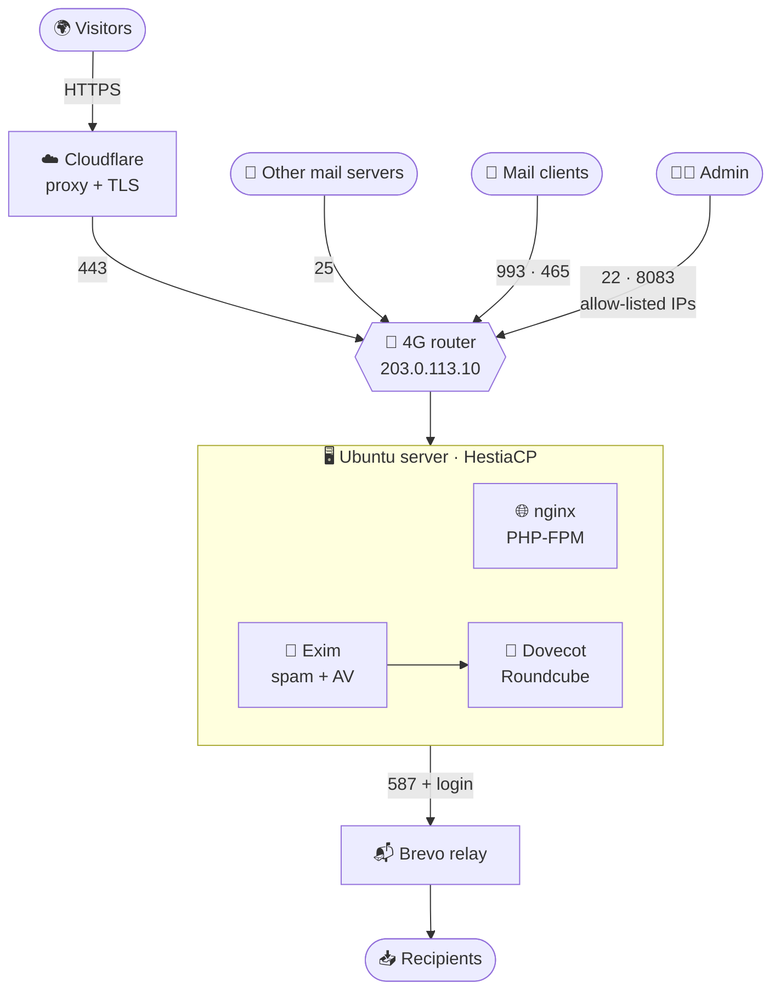
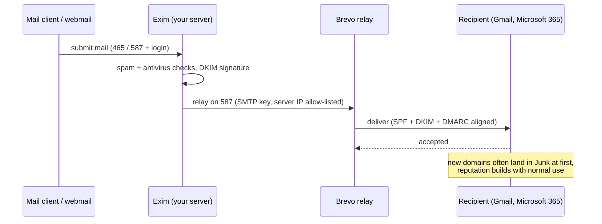
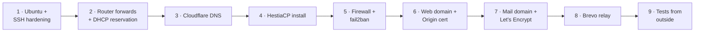

# 🏠 Ubuntu + HestiaCP Home Lab

**Websites, mail and WordPress on a 4G connection, behind Cloudflare, with a Brevo SMTP relay.**

[Architecture](#%EF%B8%8F-architecture) · [Docs](#-documentation) · [Scripts](#%EF%B8%8F-scripts) · [Lessons learned](#-lessons-learned) · [Placeholders](docs/00-placeholders.md)

---

A documented, reproducible build of a small self-hosted server: **one physical Ubuntu PC** behind a 4G router with a
static public IP, running **HestiaCP** for websites and mail. Cloudflare sits in front of the websites, and Brevo relays
outgoing mail.

Everything is written from a real build, mistakes included. The [troubleshooting guide](docs/07-troubleshooting.md)
is probably the most useful part.

> [!NOTE]
> All domains, addresses and names here are placeholders (see [docs/00-placeholders.md](docs/00-placeholders.md)).
> Replace them with your own.

## ✨ What you get

| Feature | Details |
|---|---|
| 🌐 **Websites** | a static site and WordPress, served by Hestia's nginx + PHP-FPM |
| ✉️ **Mail** | receive on port 25, IMAP/SMTP for clients, Roundcube webmail, SpamAssassin, ClamAV |
| 📤 **Outgoing relay** | a 4G IP has no reverse DNS, so mail goes out through Brevo instead of landing in spam |
| 🛡️ **Edge protection** | Cloudflare proxy (Full strict TLS with an Origin certificate), WAF rules for WordPress |
| 🔐 **Hardening** | key-only SSH, firewall limited to admin addresses, fail2ban, automatic security updates |
| 📊 **Status** | a one-screen script: CPU, RAM, disk, services, mail queue, certificate expiry |

## 🗺️ Architecture

<b>How an outgoing message travels</b>

<b>Rebuild order</b>

## 🧱 Stack

| Layer | Choice | Why |
|---|---|---|
| OS | Ubuntu Server 24.04 LTS, bare metal | simple, long support |
| Panel | HestiaCP | web + mail + firewall in one tool |
| Web | nginx + PHP-FPM (Hestia) | lighter than Apache + nginx |
| Mail | Exim, Dovecot, Roundcube, SpamAssassin, ClamAV | Hestia's built-in stack |
| Edge | Cloudflare (proxy for web, DNS only for mail names) | hides the web IP, free WAF |
| Relay | Brevo SMTP on port 587 | good IP reputation, free tier |
| TLS | Cloudflare Origin cert (web), Let's Encrypt (mail) | Origin certs are not trusted by mail clients |

## 📚 Documentation

| | Document | Use it when |
|---|---|---|
| 🔤 | [00 · Placeholders](docs/00-placeholders.md) | you need to know what an example value stands for |
| 🧭 | [01 · Architecture and inventory](docs/01-architecture-and-inventory.md) | you want the full picture of what runs where |
| 🔨 | [02 · Rebuild from scratch](docs/02-rebuild-from-scratch.md) | the machine died and you need the same state back |
| 🌍 | [03 · DNS records (Cloudflare)](docs/03-dns-cloudflare.md) | setting up or checking DNS, SPF, DKIM, DMARC |
| 📬 | [04 · Brevo SMTP relay](docs/04-brevo-smtp-relay.md) | outgoing mail setup and key rotation |
| 📡 | [05 · Router port forwards](docs/05-router-port-forwards.md) | restoring or replacing the router |
| 🔀 | [06 · Public IP or router change](docs/06-public-ip-or-router-change.md) | the public address changed |
| 🩺 | [07 · Troubleshooting](docs/07-troubleshooting.md) | something is broken |
| 🚇 | [08 · Hestia panel via SSH tunnel](docs/08-hestia-panel-via-ssh-tunnel.md) | reaching the panel without exposing it |
| 🛡️ | [09 · Security hardening](docs/09-security-hardening.md) | tightening the setup and testing it from outside |
| 🔍 | [10 · External security review prompt](docs/10-external-security-review-prompt.md) | a scoped prompt for reviewing your own deployment |

## 🛠️ Scripts

Settings come from environment variables; run with `sudo -E`. **Read each script before running it.**

| Script | What it does | Changes the system? |
|---|---|:---:|
| [`harden-ssh.sh`](scripts/harden-ssh.sh) | key-only SSH, no root login, `AllowUsers`, locks root, automatic updates | ✅ |
| [`install-origin-cert.sh`](scripts/install-origin-cert.sh) | installs a Cloudflare Origin certificate on a Hestia web domain | ✅ |
| [`harden-wp.sh`](scripts/harden-wp.sh) | WordPress: hides user enumeration, generator tag, XML-RPC, readme/license | ✅ |
| [`enable-clamav.sh`](scripts/enable-clamav.sh) | installs ClamAV, enables it for a mail domain (about 1 GB RAM) | ✅ |
| [`get-status.sh`](scripts/get-status.sh) | CPU, RAM, disk, services, mail queue, TLS expiry, updates | ❌ read-only |

## 💡 Lessons learned

> [!TIP]
> **Receive directly, send through a relay.** A 4G public IP usually has no reverse DNS, so direct sending is rejected or spam-foldered.

> [!WARNING]
> **Keep Docker, ufw and fail2ban off the machine before installing HestiaCP.** It brings its own firewall and fail2ban, and the installer wants a clean OS.

- 📌 Hestia's nginx binds to the server's **LAN address**: give it a DHCP reservation
- 🔒 Never use a Cloudflare **Origin certificate for mail** names: clients do not trust it
- 🧾 Keep exactly **one SPF and one DMARC** record, and replace Cloudflare's automatic "no mail" records
- 🧱 Cloudflare-proxied sites reach the firewall as Cloudflare's addresses: **block attackers at Cloudflare**, not with fail2ban
- 🧪 Test allow-lists from an address that is **not** on the list (a phone on mobile data)
- 🗝️ Never paste secrets into scripts or chats: type SMTP keys into the panel, and rotate any key that was exposed

More in [docs/07-troubleshooting.md](docs/07-troubleshooting.md).

## ⚠️ Disclaimer

A personal lab write-up, provided as is. Read each script before running it, test on a throwaway machine first, and keep
your own backups. Nothing here is security advice for production systems.

## 📄 License

[MIT](LICENSE)
