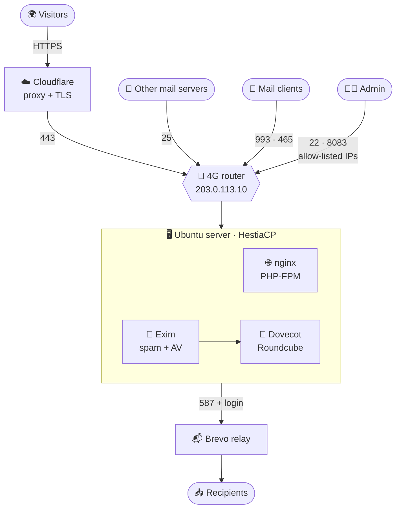

# example.com — HestiaCP web + mail server (hub)


> Personal lab, built 2026-10-23. Everything below was verified working that day:
> web (example.com), webmail, mail receive, mail send via Brevo relay, iPhone IMAP/SMTP, SSH from PC + iPhone.

## Diagram



| Name | Cloudflare proxy | Used for |
|---|:---:|---|
| `example.com`, `www`, `wordpress`, `download` | ☁️ proxied | websites |
| `host`, `mail`, `webmail` | ⚪ DNS only | server name and panel, mail (MX, IMAP, SMTP), webmail |

## Notes in this set
- [Rebuild from scratch](02-rebuild-from-scratch.md) — rebuild everything from zero (PC died / reinstall)
- [Public IP or router change](06-public-ip-or-router-change.md) — public IP changed or router replaced
- [Router port forwards](05-router-port-forwards.md) — router port-forward table + settings (copy of the UI)
- [Brevo SMTP relay](04-brevo-smtp-relay.md) — Brevo relay: account, domain auth, authorized IP, SMTP key, Hestia setup, rotation
- [DNS records (Cloudflare)](03-dns-cloudflare.md) — every DNS record + why
- [Troubleshooting](07-troubleshooting.md) — gotchas, symptom → fix, log locations, health checks
- [Hestia panel via SSH tunnel](08-hestia-panel-via-ssh-tunnel.md) — panel via SSH tunnel

## What it is (one paragraph)
- One physical Ubuntu PC at home/office behind a 4G router with a static public IP
- HestiaCP (bare metal, no Docker) hosts: static website `example.com` + mail for `@example.com` (Exim, Dovecot, Roundcube, SpamAssassin, ClamAV)
- Cloudflare = DNS + proxy for the website; mail names are DNS-only (grey cloud)
- Outgoing mail goes through Brevo SMTP relay (4G IP has no PTR / bad reputation); incoming mail comes straight to the server on port 25

## Architecture
```
Visitors ─► Cloudflare (orange, TLS, SSL mode Full strict) ─► 203.0.113.10:443 ─► 4G router ─► 192.168.1.50:443 ─► Hestia nginx ─► /home/webuser/web/example.com/public_html
Gmail/365 ─25─► 203.0.113.10 ─► router ─► 192.168.1.50 Exim ─► Dovecot mailbox admin@example.com
iPhone/Outlook ─993 IMAP / 465 SMTP─► mail.example.com (DNS only) ─► same server
Exim ─587 + login─► smtp-relay.brevo.com ─► internet   (outgoing, DKIM/SPF/DMARC aligned via Brevo + example.com DNS)
Admin ─SSH 22 / panel 8083─► only from PC IP, LAN, (iPhone IP)
```

## Inventory
| Item | Value |
|---|---|
| Server | physical PC, Intel i3, 8 GB RAM (7.4 GiB), 240 GB NVMe (`/dev/nvme0n1`) |
| OS | Ubuntu 24.04.5 LTS |
| Hostname | `host.example.com` (short `host`) — was `ubuntu` before |
| NIC / LAN IP | `enp3s0` · `192.168.1.50/24` · gateway `192.168.1.1` (4G router) · DHCP **reservation** on router |
| Public IP | `203.0.113.10` (4G operator static IP) |
| 4G router LAN | `192.168.1.0/24`, router `192.168.1.1` (admin password changed; disable remote/WAN admin) |
| Admin PC | `admin-pc` (WSL) at the office · egress public IP `198.51.100.20` · DNS there = `corp-dns.example.local` `10.0.0.5` |
| iPhone | Termius SSH + Mail app · mobile IP changes (was `198.51.100.77`) |
| Hestia | 1.10.5-1+ubuntu24.04 · panel `https://host.example.com:8083` |
| Domain | `example.com` (registrar/DNS: Cloudflare) |
| Relay | Brevo · `smtp-relay.brevo.com:587` · login `xxxxxxxx@smtp-brevo.com` (key NOT stored here) |

## Accounts (no passwords here → password manager)
| Account | Where | Notes |
|---|---|---|
| `sysadmin` | Linux, sudo, SSH | key-only; keys: `you@company.example` (PC) + `termius-iphone` |
| `admin` | Hestia panel admin | verify with `sudo /usr/local/hestia/bin/v-list-users` |
| `webuser` | Hestia user (owns web + mail) + Linux user | SSH allowed ONLY from `127.0.0.1` (File Manager) |
| `admin@example.com` | mailbox | IMAP/SMTP/Roundcube |
| Cloudflare | account | holds DNS + Origin CA |
| Brevo | account | SMTP key in Hestia (per-domain relay); key expires after 1 year / 90 days idle |

! Password manager must hold: admin + webuser panel passwords, mailbox password, Brevo SMTP key, Cloudflare Origin **private key** (shown only once at creation), Cloudflare/Brevo logins

## Security setup
- SSH `/etc/ssh/sshd_config.d/00-hardening.conf` (file name `00-` wins over cloud-init `50-`):
```
PermitRootLogin no
PasswordAuthentication no
KbdInteractiveAuthentication no
PubkeyAuthentication yes
PermitEmptyPasswords no
AllowUsers sysadmin webuser@127.0.0.1
MaxAuthTries 3
LoginGraceTime 30
X11Forwarding no
ClientAliveInterval 300
ClientAliveCountMax 2
```
- `sudo passwd -l root` (root locked) · unattended-upgrades on (`/etc/apt/apt.conf.d/20auto-upgrades`)
- Firewall = Hestia iptables (`v-list-firewall`), ufw + docker REMOVED. Rules (IDs can change):
  - 22/tcp → `198.51.100.20` (PC) + `192.168.1.0/24` (+ iPhone IP when needed) — NOT 0.0.0.0/0
  - 8083/tcp → `198.51.100.20` + `192.168.1.0/24`
  - 80,443 · 25,465,587 · 143,993 · 110,995 → any (110/995/143 have no listener except 993)
  - ICMP any
- fail2ban (Hestia jails): `ssh-iptables`, `dovecot-iptables`, `exim-iptables`, `hestia-iptables`, `phpmyadmin-auth`, `recidive`
  - ! add own IPs to `ignoreip` in `/etc/fail2ban/jail.local` `[DEFAULT]` (own failed panel logins ban own IP)
- nginx waits for network: `/etc/systemd/system/nginx.service.d/wait-network.conf` (`After=` + `Wants=network-online.target`) — verify exists

## 4G router (model-specific, do on the router UI)
- DHCP reservation: server MAC (`ip -br link show enp3s0`) → `192.168.1.50`
- Port forwards (router menu "Virtual Servers"), all TCP, WAN port = LAN port, remote host empty, LAN IP `192.168.1.50`:

| Name on router | Port | Purpose |
|---|---|---|
| ubuntu SSH | 22 | SSH (Hestia firewall limits sources) |
| 80 | 80 | HTTP (Cloudflare → origin, Let's Encrypt) |
| 443 | 443 | HTTPS website + webmail |
| 25 | 25 | SMTP receive from other servers |
| 8083 hestia | 8083 | Hestia panel — ! the router forwards it to everyone; ONLY Hestia firewall rules (PC IP + LAN) keep it private → never delete those rules |
| 993 | 993 | IMAPS |
| 465 | 465 | SMTPS submission |
| 587 | 587 | SMTP submission (STARTTLS) |

- Alternative for 8083: delete that forward and use the SSH tunnel ([Hestia panel via SSH tunnel](08-hestia-panel-via-ssh-tunnel.md)) → panel never exposed
- Admin password changed, remote (WAN) admin OFF
- 4G operator allows inbound 25/80/443 and outbound 25/587 (tested) — a new SIM/operator must be re-tested (CGNAT breaks everything)

## Where things live on the server
| What | Path |
|---|---|
| Website files | `/home/webuser/web/example.com/public_html/` |
| Web SSL (Origin cert) | `/home/webuser/conf/web/example.com/ssl/` (Hestia copy) · original `/srv/web/nginx/certs/example.com.{pem,key}` (leftover from Docker era) |
| Mail domain data / DKIM key / relay | `/etc/exim4/domains/example.com/` (`dkim.pem`, `smtp_relay.conf`, `antivirus`) |
| Mailboxes | `/home/webuser/mail/example.com/sysadmin/` |
| Exim config | `/etc/exim4/exim4.conf.template` (backup `…template.bak.2026-10-23-105121`) |
| Hestia config | `/usr/local/hestia/conf/hestia.conf` (`ANTIVIRUS_SYSTEM='clamav-daemon'`) |
| Logs | `/var/log/exim4/mainlog` · `/var/log/dovecot.log` (root) · `/var/log/nginx/domains/*.log` · `/var/log/auth.log` · `/var/log/hestia/{error,auth,nginx-error}.log` |
| Old Docker-era leftovers | `/srv/web/` (certs!, old compose + sites) — safe to delete AFTER copying certs elsewhere |

## Backup checklist (not automated yet → TODO)
- Off-box copies of: Origin cert + key, `/etc/exim4/domains/example.com/dkim.pem`, `/etc/ssh/ssh_host_*`, `~/.ssh/authorized_keys`, mailbox dir, site files
- Hestia backups: `sudo /usr/local/hestia/bin/v-backup-user webuser` → `/backup/*.tar` → scp to PC / NAS (1 slot by default: `BACKUPS` in package)
- If DKIM key is lost → Hestia makes a new one → must update `mail._domainkey` TXT in Cloudflare

## Added later on 2026-10-23
- WordPress: Hestia web domain `wordpress.example.com` (user `webuser`, Let's Encrypt cert, Cloudflare proxied) → Web → domain → Quick Install App → WordPress (creates its own database `begela_…` automatically; check DB tab)
  - subdomain how-to: Web → Add Web Domain with the full name (remove the auto `www.` alias) + proxied Cloudflare record; SSL via Let's Encrypt or the Origin cert (`v-add-web-domain-ssl`)
- Status script: `/home/sysadmin/get-status.sh` (`~/get-status.sh`, `sudo ~/get-status.sh` for mail queue + top processes)
  - shows CPU %, RAM/swap GB, disk GB, temp, service ✔/✘, mail queue, mail TLS cert days left, SSH probes today, pending updates, reboot flag
  - `/proc` is mounted `hidepid=invisible` → non-root sees only its own processes

## Open items
- New Brevo SMTP key (the first one appeared in chat) → panel → Mail → example.com → SMTP Relay → delete old key in Brevo
- WordPress `wp.example.com` (Hestia web domain + DB; Origin cert already covers `*.example.com`)
- Backups (above)
- 365 puts mail in Junk until domain reputation builds → mark Not junk, reply, send normal mail
- Autodiscover/SRV skipped on purpose (manual client setup)
- Known harmless: system mail to `*@host.example.com` loops in Exim (left as is)
